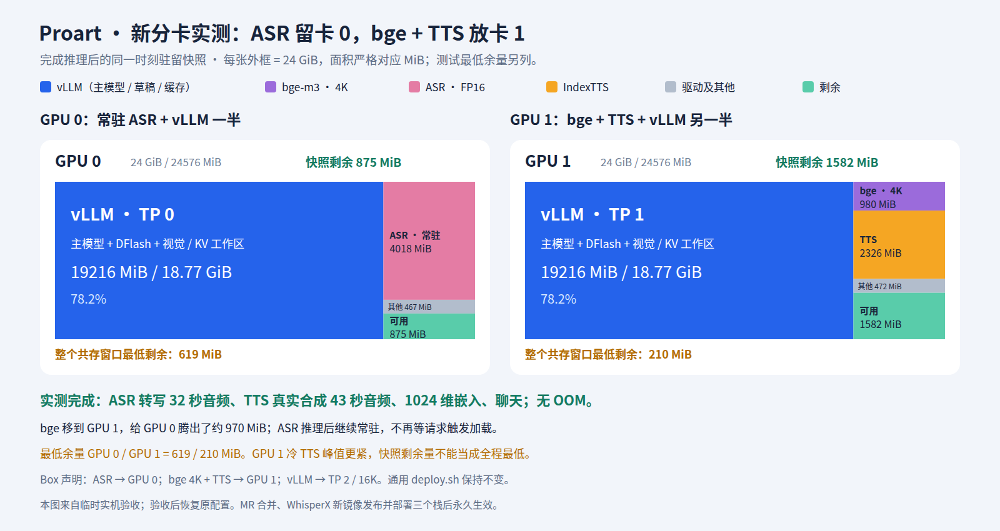

# vLLM chat on Proart

The AI stack serves text and single-image chat with `orcarouter/Qwen3.8-27B-Uncensored-FP8`
and the `z-lab/Qwen3.8-27B-DFlash2` speculative draft. Ollama continues
serving `bge-m3` on GPU 1 alongside IndexTTS. The STT stack keeps its
FP16 `large-v3` ASR model resident on GPU 0.

The vLLM endpoint is internal: `http://vllm-server:8000/v1`, model
`home-chat`. It has no published host port. Configure the existing
OllamaGateway as an OpenAI-compatible provider to expose it through the
existing authenticated gateway and Open WebUI. Its provider Base URL must
be `http://vllm-server:8000` without `/v1`: OllamaGateway adds `/v1` itself.

## Image inputs

The target checkpoint includes the vision encoder and processor. The service
accepts one image per prompt and disables video. This also applies to images
retained in earlier turns, including PhotoRanking's three-turn summary flow.
OllamaGateway can translate Ollama `images` inputs to OpenAI chat completions;
keep the provider configured as OpenAI-compatible with chat-completions support.
Do not enable `--language-model-only`: it rejects every image request with HTTP 400.

The vision encoder uses weight tensor parallelism across both GPUs, with BF16
vision weights. Image processing is bounded to 1,048,576 pixels (about 1 MP),
preserving aspect ratio; larger images are resized before encoding. This bounds
vision activation memory on the shared GPUs. Text precision, DFlash2, and the
16K context limit remain unchanged. Image tokens count toward that context.

## Prepare model files

The existing `deploy.sh` discovers this stack and creates its declared bind
mount directories through the same path used by every business stack. With
the model files restored, run normal Box deployment to start vLLM with all
GPU, memory, model and restart settings from Compose. No separate serving
command or AI-specific deployment hook is needed. Swarm restores the service
after a normal server reboot.

For a rebuilt server, restore the usual Box environment and persistent
application volumes, including `/swarm-vol/ssd/ai/vllm/huggingface-hub`, then
run `sudo bash deploy.sh`. The compilation cache at
`/swarm-vol/ssd/ai/vllm/cache` can be empty: vLLM rebuilds it automatically.

If model weights were also lost, the offline vLLM container cannot become
healthy until they are restored. Complete the manual login/download step
below, then let Swarm retry or rerun Box deployment. This data preparation
step does not change `deploy.sh` or require a manual serving container.

The target is gated on Hugging Face. An operator must accept its access
conditions using an account permitted to download the weights. Do not place
that account's token in Compose, `.env.prod`, source control, or chat.

Open the [target repository](https://huggingface.co/orcarouter/Qwen3.8-27B-Uncensored-FP8)
in a browser using the same account that will log into the CLI. Review and
submit the access form, then confirm access has been granted before downloading.
A successful `hf auth login` authenticates the account; it does not accept the
repository's conditions. If downloading reports `requires approval`, complete
this browser step instead of repeatedly logging in. If the request is pending,
wait for the repository owner to grant access.

After preparing the official vLLM image through the existing registry,
run the following **on Proart**. It downloads weights without starting GPU
inference or stopping the existing model:

```bash
sudo mkdir -p /swarm-vol/ssd/ai/vllm/huggingface-hub /swarm-vol/ssd/ai/vllm/cache
sudo docker run --rm -it \
  --entrypoint /bin/bash \
  -v /swarm-vol/ssd/ai/vllm/huggingface-hub:/root/.cache/huggingface/hub \
  hub.aiursoft.com/vllm/vllm-openai:latest \
  -lc 'hf auth login && hf download orcarouter/Qwen3.8-27B-Uncensored-FP8 && hf download z-lab/Qwen3.8-27B-DFlash2'
```

Only the model cache is mounted. Login credentials remain inside the temporary
container and are removed with it after exit; do not enable Git credential
storage at the login prompt. Interrupted downloads can resume by repeating
the command. Serving mounts only the model cache read-only and enables
`HF_HUB_OFFLINE=1`, so no Hugging Face token is needed at runtime. The
persistent vLLM compilation cache is separate.

## Switch from Ollama chat

Do not start both chat models together. The existing Qwen runner is kept
resident by both Ollama and gateway warmup requests.

1. Record the current gateway provider, warmup entries, and virtual-model
   routes using the normal administrator interface. Preserve any required
   rollback configuration using the established backup procedure.
2. Remove only `qwen3.8:27b` from Ollama provider warmup. Keep the `bge-m3`
   embedding warmup and all unrelated providers and routes.
3. Drain active requests to the old local chat backend and move its routes
   to an available fallback, or temporarily disable them. Confirm no warmup
   or new chat request can reload it.
4. Stop `qwen3.8:27b` through Ollama and verify that it has left `ollama ps`.
   Keep its weight files available until the new service passes acceptance.
5. Deploy the reviewed AI stack through the existing Box deployment process.
   Wait for vLLM health and complete independent acceptance. Keep fallback
   routes until an operator explicitly approves switching traffic; starting
   the service alone does not authorize a gateway cutover. Then configure
   the OpenAI-compatible provider at
   `http://vllm-server:8000` with maximum parallelism 1, chat-completions
   support, and model `home-chat`. Preserve existing public virtual-model
   names when switching their local chat routes.
6. Verify direct inference, gateway streaming and cancellation, Open WebUI
   chat, and unchanged embedding and speech services before restoring traffic.

The node uses the NVIDIA default container runtime. vLLM makes both GPUs
visible with `NVIDIA_VISIBLE_DEVICES=0,1`. Ollama and IndexTTS expose only
host GPU 1. Each single-GPU container selects its logical CUDA device 0.
This groups embeddings and speech synthesis on GPU 1. The STT stack exposes
only host GPU 0 and enables `WHISPERX_PRELOAD=true`, loading the configured
ASR model before it becomes healthy. vLLM shards equally across both cards.



This diagram records one post-inference snapshot from the 2026-11-16
coexistence test, not live telemetry. The full test's minimum free memory
was 619 MiB on GPU 0 and 210 MiB on GPU 1; those minima are marked separately
from the snapshot areas. The [editable SVG](docs/gpu-allocation-2026-11-16.svg)
and [source values](docs/gpu-allocation-2026-11-16.json) are kept alongside
this image. Ollama defaults to a 4,096-token
context for bge-m3 through `OLLAMA_CONTEXT_LENGTH`. This is an input-length
limit, not a guarantee of lower resident memory. The vLLM image, precision,
and 16K chat context remain unchanged.

Deploy the AI, ReporterTTS and STT stacks together through the existing Box
workflow. The normal full `sudo bash deploy.sh` includes all three; an AI-only
filter does not update the other stacks. The WhisperX image must include the
resident-model implementation from ExternalImages MR !51 before deploying
the STT preload setting. Existing model caches and normal service credentials
remain prerequisites; no separate inference launch command is required.

Do not add a Swarm `NVIDIA-GPU` generic-resource reservation to these shared
services: Swarm reserves whole devices rather than remaining VRAM. Use the
NVIDIA runtime visibility variables to select devices. A reservation value
is a quantity, not a physical GPU index.

vLLM uses two RTX 3090 GPUs with tensor parallelism 2. Its KV pool is explicitly
limited to 960 MiB per GPU for one 16K request. The 76% GPU utilization setting
is a startup allowance; the explicit KV size overrides automatic KV sizing.
Neither setting is a hard limit on transient CUDA workspace usage.

Measure free memory on **each** GPU during startup and concurrent chat,
embedding and speech acceptance. Actual successful inference is the acceptance
criterion; 800 MiB is a planning target, and smaller headroom can be accepted
when measured workloads complete without OOM. Measure peak non-vLLM usage with
vLLM stopped first, using short and long prose, poetry, and the first synthesis
after speech startup. Then verify the services together. Count embedding
memory once when using the total GPU measurement. Idle speech memory is
insufficient. Do not copy a 90% dedicated-GPU setting onto this shared machine.

## Precision and latency

FP8 weights run through the Ampere-compatible W8A16 Marlin path. Verify the
selected kernels in startup logs. Activations and attention KV use BF16;
GDN SSM state uses FP32. The draft is the unquantized BF16 checkpoint.
The target checkpoint determines weight quantization automatically.

The total context limit is 16,384 tokens, including input, reasoning, and
visible output. One request runs at a time. DFlash2 proposes two tokens per
step with standard rejection sampling; it preserves the deployed target's
sampling distribution rather than the original unmodified BF16 model.
Modified weights can reduce draft acceptance, which requires measurement.
Do not use approximate verification to improve speed.

Two proposals and 1,024-token prefill chunks reduce verification state and
activation workspace on this shared machine. They trade some speed for
headroom while retaining target/draft precision and the 16K context limit.

Preserve the checkpoint's default xhigh reasoning for quality-first chat.
Callers can explicitly request medium or low, but lowering reasoning effort
is a quality/latency tradeoff, not lossless acceleration. Track both the first
reasoning token and the first visible answer: long reasoning can exhaust a
16K budget before producing an answer. Compare models with the same explicit
effort when evaluating them, and also test the default effort separately.

Prefix caching is initially disabled to establish a baseline. Enable it only
after testing repeat-prefix correctness with this hybrid model and DFlash2.
Keep NVLink peer communication enabled; do not set `NCCL_P2P_DISABLE=1`.

## Acceptance and rollback

Record image/model revisions as deployment evidence without pinning source
configuration to an upstream hash. Check:

- Both GPUs participate, the intended FP8/Marlin path is selected, and there
  is headroom during chat, embedding, and speech running together.
- Chinese multi-turn chat, factual uncertainty, reasoning, formatting, and
  benign sensitive-topic discussions complete without regressions against
  the previous model. Lower refusal alone does not establish answer quality.
- DFlash2-on versus target-only latency, acceptance length, completion rate,
  and streaming work at short and near-limit contexts. Do not treat advertised
  sibling-model token rates as this deployment's measured performance.
- `/health` and `/v1/models`, gateway model discovery, nonstreaming and SSE,
  cancellation, queueing, over-limit rejection, and service restart work.
- Single-image OCR, visual questions, and image-bearing multi-turn requests
  work through both OpenAI and Ollama gateway APIs. Check image limits and
  simultaneous image inference, embedding, and speech memory peaks.
- `bge-m3` still returns 1,024-dimensional embeddings and the old Qwen does
  not reappear after a gateway warmup cycle. Speech still works.

If acceptance fails, stop the vLLM service before re-enabling the previous
Qwen route and warmup configuration. Reload the retained Ollama weights and
verify chat and embeddings. Do not restore the old chat model while vLLM
still occupies the GPUs.
